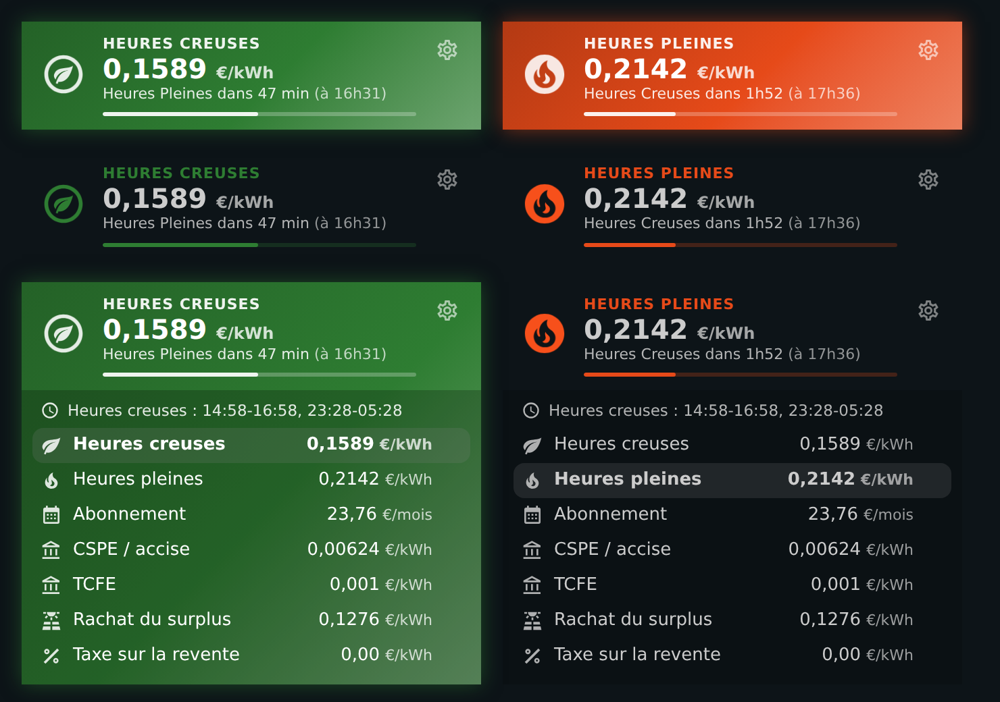
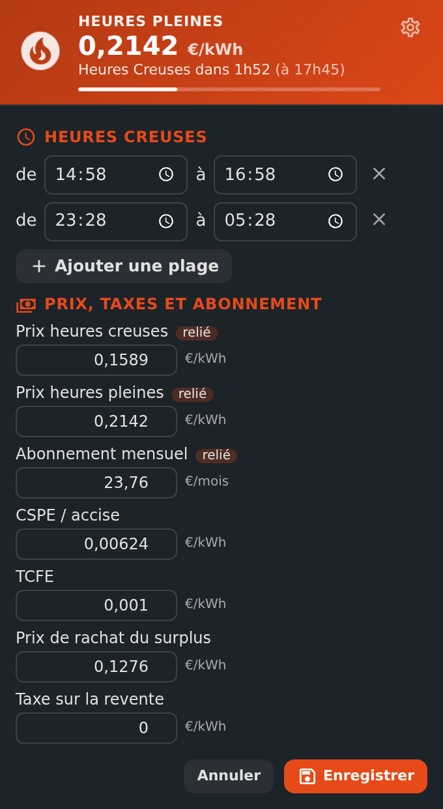
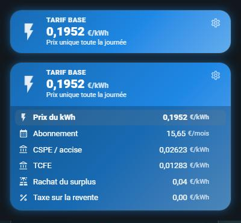
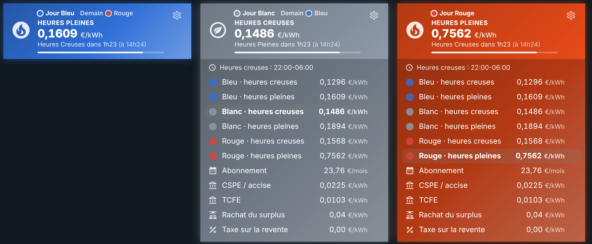

# ⚡ HOLM HP/HC, pricing and subscription

[](https://hacs.xyz/)


[🇫🇷 Français](README.md) · 🇬🇧 English

**Off-peak or peak hours? The right price, the next switch and your subscription, in one place — no Jinja template or hacked-together card.**

HOLM HP/HC (*heures pleines / heures creuses*: peak / off-peak hours, as in French electricity contracts) always knows whether you are in **off-peak** or **peak hours**, from your time ranges (or your Linky meter). It derives the **current price**, announces the **next switch** and groups your **prices, taxes and subscription**. Your automations, the Energy dashboard and the other HOLM cards rely on the same reference.

> 💡 The period does **not** depend on the price: when your supplier changes its prices, just update them, nothing switches by mistake.

### At a glance

- 🌗 **Off-peak ranges** in plain text: `14:58-16:58, 23:28-05:28` — as many ranges as needed, including across midnight, DST changes included.
- 🔵⚪🔴 **Tempo option (EDF, France)**: today's and tomorrow's colour (found automatically with RTE Tempo), 6 prices, and the current price based on colour and period.
- 💡 **Base option (single price)**: one kWh price all day, no off-peak hours — with subscription and taxes as usual.
- 📟 **Optional Linky meter**: if your meter reports the current period, it takes priority over the schedule.
- 💶 **Prices, taxes and subscription held by the integration**: entered at setup, then editable in Home Assistant or **from the card**. Nothing to create beforehand.
- 🔗 **Existing helpers linked**: already had your `input_number`s (Energy dashboard, cards)? They are detected and kept in sync both ways.
- ⏱️ **Next switch** to the minute, and an **event** on each change for your automations.
- 🧾 **Subscription, CSPE / excise, TCFE, buy-back price and tax** grouped, with the subscription broken down **per day**.
- 🎨 **HOLM HP/HC card**: green in off-peak hours, orange in peak hours (coloured background optional), with a **Settings** part for ranges and prices.
- 🌍 **8 languages**: English, French, German, Spanish, Italian, Dutch, Portuguese and Polish (integration and card).

| Coloured, partial or theme background | Settings in the card |
|---|---|
|  |  |

*Screenshots in French — the card follows the language of your Home Assistant profile.*

### 🆕 What's new in 1.3.0

- 💡 **Base option (single price)**: a third tariff option, next to *Off-peak / peak hours* and *Tempo*. One kWh price (`number.tarif_prix_base`), given by `sensor.tarif_actuel` at any time; the off-peak-only entities are removed. See [Base option](#base-option-single-price).
- 🎨 **HOLM HP/HC card with Base**: "Base rate", the kWh price and "Same price all day", in its own colour (`colors.base`); the settings no longer show off-peak ranges.
- 🔗 `sensor.tarif_actuel` tells the chosen option (`option` attribute: `hchp`, `tempo` or `base`). The [HOLM Ecojoko Card](https://github.com/kaaribou/holm-ecojoko-card) 1.5.0 uses it to take your prices automatically, Base included.
- If you don't change the option, nothing changes.



---

## Installation

### With HACS (recommended)

1. HACS → ⋮ menu → **Custom repositories** → add `https://github.com/kaaribou/holm-tarif`, category **Integration**.
2. Search for **HOLM HP/HC** → **Download**, then restart Home Assistant.

### Manually

Copy `custom_components/holm_tarif` into the `custom_components` folder of your configuration, then restart Home Assistant.

## Configuration

**Settings → Devices & services → Add integration → HOLM HP/HC.**

1. **Tariff option**: *Off-peak / peak hours*, *Tempo (EDF)* or *Base (single price)*.
2. **Off-peak ranges**: `14:58-16:58, 23:28-05:28` (a range can cross midnight); ignored with Base.
3. **Prices, taxes and subscription**: off-peak and peak kWh prices (or the Base kWh price), monthly subscription, CSPE / excise, TCFE, surplus buy-back price and tax. Everything is optional except what you need.
4. **Tempo option** (if chosen): the 6 prices and the entity giving today's (and tomorrow's) colour — see [Tempo option](#tempo-option).
5. **Existing helpers and meter** (optional):
   - if you already have price helpers (`input_number`) used by the Energy dashboard or your cards, **link them**: they are detected automatically, and every price change updates them (and vice versa);
   - if your Linky meter reports the current period, choose it: it takes priority over the schedule.

Everything can then be changed in **Configure**, or straight from the card (⚙ button).

## Entities

| Entity | Value |
|---|---|
| `binary_sensor.heures_creuses` | On during off-peak hours — the reference for your automations |
| `sensor.mode_heure` | `Heures Creuses` / `Heures Pleines` (off-peak / peak) |
| `sensor.tarif_actuel` | Current kWh price (€/kWh), with all prices as attributes and the tariff option (`option`) |
| `sensor.prochain_changement_de_mode` | “Heures Pleines dans 1h37m” (peak hours in 1h37m) |
| `sensor.prochaine_bascule` | Date and time of the next switch |
| `sensor.abonnement_par_jour` | Monthly subscription per day (€) |
| `number.tarif_prix_hc`, `number.tarif_prix_hp` | Off-peak / peak kWh price (editable) |
| `number.tarif_abonnement` | Monthly subscription |
| `number.tarif_cspe`, `number.tarif_tcfe` | Taxes per kWh |
| `number.tarif_prix_rachat`, `number.tarif_taxe_revente` | Solar surplus buy-back |

*Entity IDs and state values are in French.*

**Event** `holm_tarif_changement` on each switch (`periode`, `heures_creuses`, `tarif`, `prochaine_bascule`):

```yaml
triggers:
  - trigger: state
    entity_id: binary_sensor.heures_creuses
    to: "on"
actions:
  - action: switch.turn_on
    target:
      entity_id: switch.water_heater
```

## Tempo option

With the **Tempo (EDF)** tariff option, the integration takes the day colour into account:

- **Today's and tomorrow's colour**: with the [RTE Tempo](https://github.com/hekmon/rtetempo) integration, they are found automatically. Otherwise, choose any entity whose state is Bleu / Blanc / Rouge (Linky meter, ZLinky…). If the source is briefly unavailable, the last known colour is kept.
- **6 prices**: Blue, White and Red, off-peak and peak, editable like the others (`number.tarif_prix_bleu_hc` … `number.tarif_prix_rouge_hp`).
- **Off-peak hours**: your ranges (22:00-06:00 for Tempo) or your meter, as usual.
- **`sensor.tarif_actuel`** gives the price of the current colour and period: the Energy dashboard counts right, without changing anything.

| Entity | Value |
|---|---|
| `sensor.tempo_couleur_aujourdhui` | `Bleu` / `Blanc` / `Rouge` (and that colour's off-peak / peak prices as attributes) |
| `sensor.tempo_couleur_demain` | Tomorrow's colour, as soon as it is known |
| `number.tarif_prix_bleu_hc` … `number.tarif_prix_rouge_hp` | The 6 Tempo prices |

The `couleur` attribute is added to `binary_sensor.heures_creuses` and `sensor.tarif_actuel`, and the `holm_tarif_changement` event is also sent when the colour changes (with `couleur`).

The HOLM HP/HC card shows today's and tomorrow's colour, takes the day colour (`color_mode` option), and its settings show the prices per colour.



## Base option (single price)

With the **Base (single price)** tariff option, a kWh costs the same at any time (EDF's Base option, flat-rate offers):

- **One price**: `number.tarif_prix_base`, editable like the others; it can also be linked to an existing helper (*Existing helpers* section).
- **`sensor.tarif_actuel`** always gives this price (attributes `option: base`, `periode: Base`, `prix_base`, plus taxes and subscription): the Energy dashboard counts right.
- **`sensor.abonnement_par_jour`**, the subscription, taxes and surplus buy-back stay available.
- **No off-peak hours**: `binary_sensor.heures_creuses`, `sensor.mode_heure`, `sensor.prochain_changement_de_mode`, `sensor.prochaine_bascule` and the off-peak / peak prices are not created (they are removed when switching from another option to Base), and no `holm_tarif_changement` event is sent. Your off-peak / peak amounts are kept: switching back brings everything back.

| Entity | Value |
|---|---|
| `sensor.tarif_actuel` | The Base kWh price (€/kWh) |
| `sensor.abonnement_par_jour` | Monthly subscription per day (€) |
| `number.tarif_prix_base` | Base kWh price (editable) |
| `number.tarif_abonnement`, `number.tarif_cspe`, `number.tarif_tcfe`, `number.tarif_prix_rachat`, `number.tarif_taxe_revente` | As with off-peak / peak |

The HOLM HP/HC card then follows `sensor.tarif_actuel`: lightning icon, "Base rate", the kWh price and "Same price all day", in the `colors.base` colour (blue by default). With `show_details`, the **Price per kWh** row is highlighted, followed by subscription and taxes; its ⚙ settings only show prices, taxes and subscription.

> ⚠️ If your automations use `binary_sensor.heures_creuses`, review them before switching to Base: this sensor doesn't exist with this option.

### Already had your own template sensors?

If you used template sensors named **Mode heure**, **Tarif actuel** or **Prochain changement de mode**, remove them from your configuration and restart **before** adding the integration: it then takes the same entity names, and their **history continues**. Cards using them keep working unchanged.

## The HOLM HP/HC card

Added automatically to the dashboard resources: add the **HOLM HP/HC** card.

```yaml
type: custom:holm-tarif-card
background: always        # always, hc, hp or never
show_details: true        # prices and subscription
```

| Option | Description | Default |
|---|---|---|
| `language` | Card language: `fr`, `en`, `de`, `es`, `it`, `nl`, `pt`, `pl` | the profile's |
| `entity` | The integration's off-peak sensor (or "Tarif actuel" with Base) | found automatically |
| `name` | Title | Off-peak hours / Peak hours (Base rate with Base) |
| `show_details` | Show prices, taxes and subscription (editable) | `false` |
| `show_progress` | Progress bar of the current period | `true` |
| `background` | Coloured background: `always`, `hc` (off-peak only), `hp` (peak only), `never` (theme background); with Base, any value but `never` colours the card | `always` |
| `show_settings` | ⚙ **Settings** button (administrators only) | `true` |
| `colors` | `hc` and `hp`, `base` for the Base option, and `bleu` / `blanc` / `rouge` for Tempo | green / orange / blue |
| `color_mode` | Tempo: card colour from the day (`tempo`) or the period (`period`) | `tempo` |

The visual editor is available. Tapping the card opens the period details.

**Settings** (⚙ button, for Home Assistant administrators): add, edit or delete off-peak ranges with time pickers, and edit prices, taxes and subscription. **Save** applies everything immediately, without restarting. Prices linked to an existing helper are flagged: the helper is updated at the same time. With `show_details`, an administrator can also edit a price with a simple tap.

## With the other HOLM projects

- **HOLM Lektrico**: choose `binary_sensor.heures_creuses` as the off-peak source (value `on`).
- **HOLM Ecojoko Card** and energy cards: they use the same price helpers and `sensor.tarif_actuel`. Since version 1.5.0, HOLM Ecojoko Card **takes the integration's prices automatically** when its price fields are empty (off-peak / peak, Tempo, Base and buy-back price). Its Tempo option also finds `sensor.tempo_couleur_aujourdhui` and `sensor.tempo_couleur_demain`.

## FAQ

**The period doesn't change at the right time.** Check Home Assistant's time zone (*Settings → System → General*) and your ranges in **Configure**.

**My meter and the schedule disagree.** If a Linky meter is configured, it decides; the next switch shown is still computed from your ranges.

---

## Say thanks?

Like the integration? You can buy me a beer 🍺

[](https://paypal.me/kaaribou)

---

## License

Code: **MIT** license — © kaaribou. See the [CHANGELOG](CHANGELOG.md) (in French).

Part of **HOLM — Home Orchestration & Living Management**: smart management and orchestration of the home.

Other projects: [Volets HOLM](https://github.com/kaaribou/volets-holm) · [Climat HOLM](https://github.com/kaaribou/climat-holm) · [Carburant HOLM](https://github.com/kaaribou/carburant-holm) · [HOLM LaMetric](https://github.com/kaaribou/lametric-holm) · [HOLM My Menu](https://github.com/kaaribou/holm-mymenu) · [HOLM Lektrico](https://github.com/kaaribou/lektrico-holm) · [HOLM GitHub](https://github.com/kaaribou/github-holm) · [HOLM Cars](https://github.com/kaaribou/holm-cars) · [HOLM Navbar Card](https://github.com/kaaribou/holm-navbar-card) · [HOLM Climate Card](https://github.com/kaaribou/climate-card-holm) · [HOLM Music Card](https://github.com/kaaribou/holm-music-card) · [HOLM Sentinel Card](https://github.com/kaaribou/holm-sentinel-card) · [HOLM Security Card](https://github.com/kaaribou/holm-security-card) · [HOLM Recordings Card](https://github.com/kaaribou/holm-recordings-card) · [HOLM Covers Card](https://github.com/kaaribou/holm-covers-card) · [HOLM Runtime Card](https://github.com/kaaribou/holm-runtime-card) · [HOLM Power Flow Card](https://github.com/kaaribou/holm-power-flow-card) · [HOLM Energy Cards](https://github.com/kaaribou/holm-energy-cards) · [HOLM Radiator Card](https://github.com/kaaribou/holm-radiator-card) · [HOLM Floor Card](https://github.com/kaaribou/holm-floor-card) · [HOLM Ecojoko Card](https://github.com/kaaribou/holm-ecojoko-card) · [HOLM Smoke Card](https://github.com/kaaribou/holm-smoke-card) · [HOLM Family Card](https://github.com/kaaribou/holm-family-card) · [HOLM Live Power Card](https://github.com/kaaribou/holm-live-power-card) · [HOLM Solar Optimizer Card](https://github.com/kaaribou/holm-solar-optimizer-card) · [HOLM Govee Light Card](https://github.com/kaaribou/holm-govee-light-card) · [HOLM Leapmotor Card](https://github.com/kaaribou/holm-leapmotor-card).
