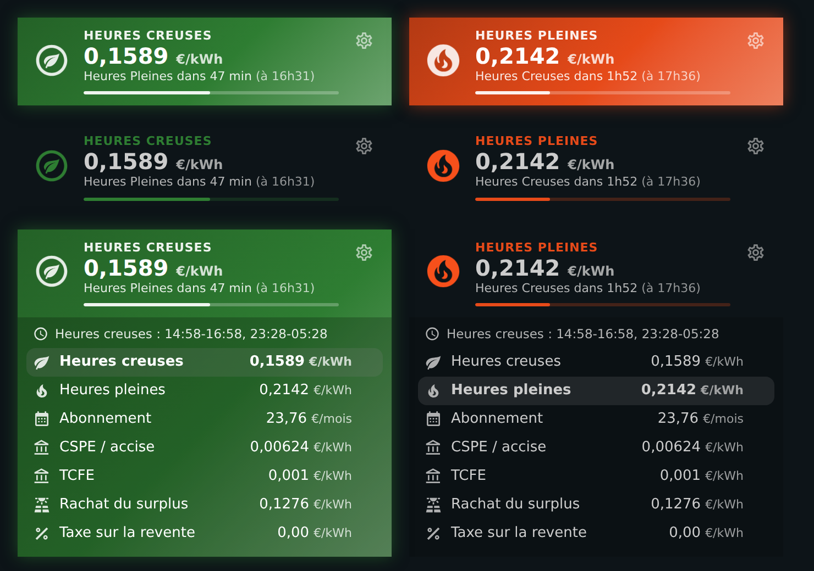
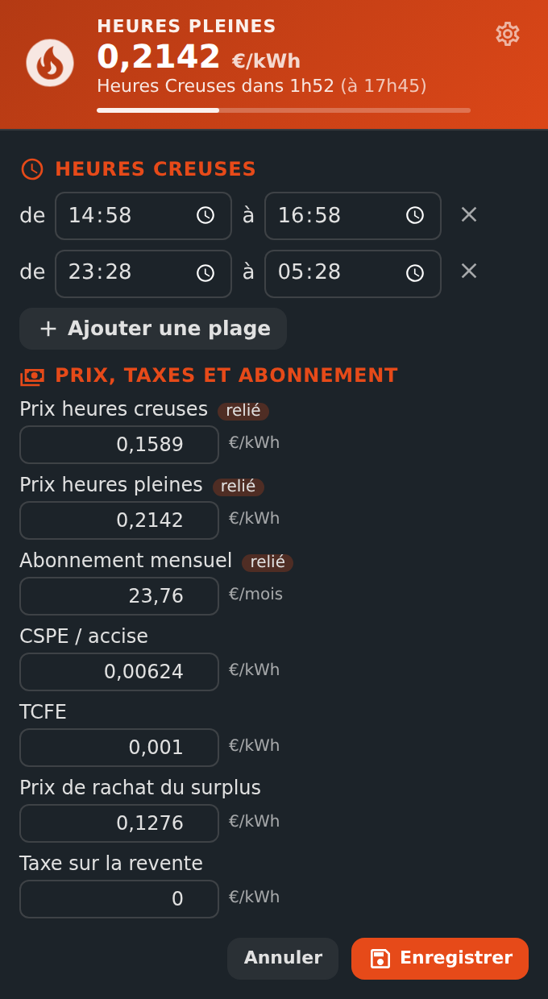
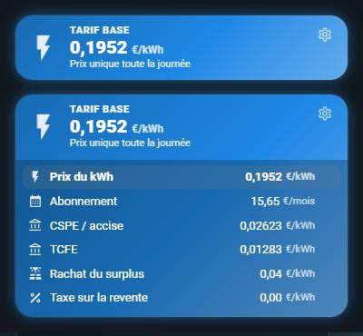
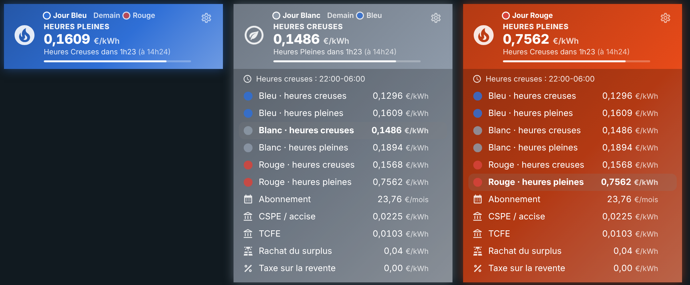

# ⚡ HOLM HP/HC, Tarification et abonnement

[](https://hacs.xyz/)


🇫🇷 Français · [🇬🇧 English](README.en.md)

**Heures creuses ou heures pleines ? Le bon tarif, la prochaine bascule et votre abonnement, au même endroit — sans modèle Jinja ni carte bricolée.**

HOLM HP/HC sait à tout moment si vous êtes en **heures creuses** ou en **heures pleines**, d'après vos plages horaires (ou votre compteur Linky). Il en déduit le **tarif en cours**, annonce la **prochaine bascule** et regroupe vos **prix, taxes et abonnement**. Vos automatisations, le tableau Énergie et les autres cartes HOLM s'appuient sur la même référence.

> 💡 La période ne dépend **pas** du prix : quand votre fournisseur change ses tarifs, il suffit de mettre à jour les prix, rien ne bascule à tort.

### En bref

- 🌗 **Plages heures creuses** en clair : `14:58-16:58, 23:28-05:28` — autant de plages que nécessaire, y compris à cheval sur minuit, changements d'heure compris.
- 🔵⚪🔴 **Option Tempo (EDF)** : couleur du jour et de demain (trouvées automatiquement avec RTE Tempo), 6 prix, et le tarif en cours selon la couleur et la période.
- 💡 **Option Base (prix unique)** : un seul prix du kWh toute la journée, sans heures creuses — avec l'abonnement et les taxes comme d'habitude.
- 📟 **Compteur Linky facultatif** : si votre compteur indique la période en cours, il prime sur les horaires.
- 💶 **Prix, taxes et abonnement portés par l'intégration** : saisis à l'installation, modifiables ensuite dans Home Assistant ou **depuis la carte**. Rien à créer avant.
- 🔗 **Entrées existantes reliées** : vous aviez déjà vos `input_number` (tableau Énergie, cartes) ? Ils sont détectés et restent à jour dans les deux sens.
- ⏱️ **Prochaine bascule** à la minute, et un **évènement** à chaque changement pour vos automatisations.
- 🧾 **Abonnement, CSPE / accise, TCFE, prix et taxe de rachat** regroupés, avec l'abonnement ramené **par jour**.
- 🎨 **Carte HOLM HP/HC** : vert en heures creuses, orange en heures pleines (fond coloré au choix), avec une partie **Réglages** pour les plages et les prix.

| Fond coloré, partiel ou aux couleurs du thème | Les réglages dans la carte |
|---|---|
|  |  |


### 🆕 Nouveautés de la 1.3.0

- 💡 **Option Base (prix unique)** : troisième option tarifaire, à côté de *Heures creuses / heures pleines* et de *Tempo*. Un seul prix du kWh (`number.tarif_prix_base`), donné par `sensor.tarif_actuel` à toute heure ; les entités propres aux heures creuses sont retirées. Voir [Option Base](#option-base-prix-unique).
- 🎨 **Carte HOLM HP/HC en Base** : « Tarif Base », le prix du kWh et « Prix unique toute la journée », dans une couleur à part (`colors.base`) ; les réglages ne montrent plus les plages heures creuses.
- 🔗 `sensor.tarif_actuel` indique l'option choisie (attribut `option` : `hchp`, `tempo` ou `base`). La carte [HOLM Ecojoko Card](https://github.com/kaaribou/holm-ecojoko-card) 1.5.0 s'en sert pour reprendre vos prix automatiquement, y compris en Base.
- Sans changer d'option, rien ne change.



---

## Installation

### Avec HACS (recommandé)

1. HACS → menu ⋮ → **Dépôts personnalisés** → ajoutez `https://github.com/kaaribou/holm-tarif`, catégorie **Intégration**.
2. Recherchez **HOLM HP/HC** → **Télécharger**, puis redémarrez Home Assistant.

### Manuellement

Copiez `custom_components/holm_tarif` dans le dossier `custom_components` de votre configuration, puis redémarrez Home Assistant.

## Configuration

**Paramètres → Appareils et services → Ajouter une intégration → HOLM HP/HC.**

1. **Option tarifaire** : *Heures creuses / heures pleines*, *Tempo (EDF)* ou *Base (prix unique)*.
2. **Plages heures creuses** : `14:58-16:58, 23:28-05:28` (une plage peut passer minuit) ; ignorées en Base.
3. **Prix, taxes et abonnement** : prix du kWh HC et HP (ou prix du kWh Base), abonnement mensuel, CSPE / accise, TCFE, prix et taxe de rachat du surplus. Tout est facultatif sauf ce dont vous avez besoin.
4. **Option Tempo** (si vous l'avez choisie) : les 6 prix et l'entité qui donne la couleur du jour (et de demain) — voir [Option Tempo](#option-tempo).
5. **Entrées existantes et compteur** (facultatif) :
   - si vous avez déjà des entrées de prix (`input_number`) utilisées par le tableau Énergie ou vos cartes, **reliez-les** : elles sont détectées automatiquement, et chaque modification de prix les met à jour (et inversement) ;
   - si votre compteur Linky indique la période en cours, choisissez-le : il prime sur les horaires.

Tout se modifie ensuite dans **Configurer**, ou directement depuis la carte (bouton ⚙).

## Entités

| Entité | Valeur |
|---|---|
| `binary_sensor.heures_creuses` | Allumé pendant les heures creuses — la référence pour vos automatisations |
| `sensor.mode_heure` | `Heures Creuses` / `Heures Pleines` |
| `sensor.tarif_actuel` | Prix du kWh en cours (€/kWh), avec tous les prix en attributs et l'option tarifaire (`option`) |
| `sensor.prochain_changement_de_mode` | « Heures Pleines dans 1h37m » |
| `sensor.prochaine_bascule` | Date et heure de la prochaine bascule |
| `sensor.abonnement_par_jour` | Abonnement mensuel ramené à la journée (€) |
| `number.tarif_prix_hc`, `number.tarif_prix_hp` | Prix du kWh en heures creuses / pleines (modifiables) |
| `number.tarif_abonnement` | Abonnement mensuel |
| `number.tarif_cspe`, `number.tarif_tcfe` | Taxes par kWh |
| `number.tarif_prix_rachat`, `number.tarif_taxe_revente` | Rachat du surplus solaire |

**Évènement** `holm_tarif_changement` à chaque bascule (`periode`, `heures_creuses`, `tarif`, `prochaine_bascule`) :

```yaml
triggers:
  - trigger: state
    entity_id: binary_sensor.heures_creuses
    to: "on"
actions:
  - action: switch.turn_on
    target:
      entity_id: switch.chauffe_eau
```

## Option Tempo

Avec l'option tarifaire **Tempo (EDF)**, l'intégration tient compte de la couleur du jour :

- **Couleur du jour et de demain** : avec l'intégration [RTE Tempo](https://github.com/hekmon/rtetempo), elles sont trouvées automatiquement. Sinon, choisissez n'importe quelle entité dont l'état est Bleu / Blanc / Rouge (compteur Linky, ZLinky…). Si la source est un moment indisponible, la dernière couleur connue est conservée.
- **6 prix** : Bleu, Blanc et Rouge, en heures creuses et en heures pleines, modifiables comme les autres (`number.tarif_prix_bleu_hc` … `number.tarif_prix_rouge_hp`).
- **Heures creuses** : vos plages (22:00-06:00 pour Tempo) ou votre compteur, comme d'habitude.
- **`sensor.tarif_actuel`** donne le prix de la couleur et de la période en cours : le tableau Énergie compte juste, sans rien changer.

| Entité | Valeur |
|---|---|
| `sensor.tempo_couleur_aujourdhui` | `Bleu` / `Blanc` / `Rouge` (et les prix HC / HP de cette couleur en attributs) |
| `sensor.tempo_couleur_demain` | Couleur de demain, dès qu'elle est connue |
| `number.tarif_prix_bleu_hc` … `number.tarif_prix_rouge_hp` | Les 6 prix Tempo |

L'attribut `couleur` est ajouté à `binary_sensor.heures_creuses` et `sensor.tarif_actuel`, et l'évènement `holm_tarif_changement` est aussi envoyé quand la couleur change (avec `couleur`).

La carte HOLM HP/HC affiche la couleur du jour et de demain, prend la couleur du jour (option `color_mode`), et ses réglages présentent les prix par couleur.



## Option Base (prix unique)

Avec l'option tarifaire **Base (prix unique)**, le kWh coûte le même prix à toute heure (option Base d'EDF, offres à prix fixe) :

- **Un seul prix** : `number.tarif_prix_base`, modifiable comme les autres ; il peut aussi être relié à une entrée existante (section *Entrées existantes*).
- **`sensor.tarif_actuel`** donne ce prix en permanence (attributs `option: base`, `periode: Base`, `prix_base`, et les taxes et l'abonnement) : le tableau Énergie compte juste.
- **`sensor.abonnement_par_jour`**, l'abonnement, les taxes et le rachat du surplus restent disponibles.
- **Pas d'heures creuses** : `binary_sensor.heures_creuses`, `sensor.mode_heure`, `sensor.prochain_changement_de_mode`, `sensor.prochaine_bascule` et les prix HC / HP ne sont pas créés (ils sont retirés si vous passez d'une autre option à Base), et aucun évènement `holm_tarif_changement` n'est envoyé. Vos montants HC / HP restent conservés : en revenant à l'option HC / HP, tout réapparaît.

| Entité | Valeur |
|---|---|
| `sensor.tarif_actuel` | Le prix du kWh Base (€/kWh) |
| `sensor.abonnement_par_jour` | Abonnement mensuel ramené à la journée (€) |
| `number.tarif_prix_base` | Prix du kWh Base (modifiable) |
| `number.tarif_abonnement`, `number.tarif_cspe`, `number.tarif_tcfe`, `number.tarif_prix_rachat`, `number.tarif_taxe_revente` | Comme en HC / HP |

La carte HOLM HP/HC suit alors `sensor.tarif_actuel` : icône éclair, « Tarif Base », le prix du kWh et « Prix unique toute la journée », dans la couleur `colors.base` (bleu par défaut). Avec `show_details`, la ligne **Prix du kWh** est mise en avant, suivie de l'abonnement et des taxes ; ses réglages ⚙ ne montrent que les prix, taxes et abonnement.

> ⚠️ Si vos automatisations utilisent `binary_sensor.heures_creuses`, revoyez-les avant de passer en Base : ce capteur n'existe pas dans cette option.

### Vous aviez déjà vos propres capteurs modèles ?

Si vous utilisiez des capteurs modèles nommés **Mode heure**, **Tarif actuel** ou **Prochain changement de mode**, supprimez-les de votre configuration et redémarrez **avant** d'ajouter l'intégration : elle reprend alors les mêmes noms d'entités, et leur **historique continue**. Vos cartes qui les utilisaient fonctionnent sans changement.

## La carte HOLM HP/HC

Ajoutée automatiquement aux ressources du tableau de bord : ajoutez la carte **HOLM HP/HC**.

```yaml
type: custom:holm-tarif-card
background: always        # always, hc, hp ou never
show_details: true        # tarifs et abonnement
```

| Option | Description | Par défaut |
|---|---|---|
| `language` | Langue de la carte : `fr`, `en`, `de`, `es`, `it`, `nl`, `pt`, `pl` | celle du profil |
| `entity` | Capteur « Heures creuses » de l'intégration (ou « Tarif actuel » en Base) | trouvé automatiquement |
| `name` | Titre | Heures creuses / Heures pleines (Tarif Base en Base) |
| `show_details` | Afficher les tarifs, taxes et abonnement (modifiables) | `false` |
| `show_progress` | Barre d'avancement de la période en cours | `true` |
| `background` | Fond coloré : `always`, `hc` (heures creuses seulement), `hp` (heures pleines seulement), `never` (fond du thème) ; en Base, tout réglage sauf `never` colore la carte | `always` |
| `show_settings` | Bouton ⚙ **Réglages** (administrateurs seulement) | `true` |
| `colors` | `hc` et `hp`, `base` pour l'option Base, et `bleu` / `blanc` / `rouge` pour Tempo | vert / orange / bleu |
| `color_mode` | Tempo : couleur de la carte selon le jour (`tempo`) ou la période (`period`) | `tempo` |

L'éditeur visuel est disponible. Un toucher sur la carte ouvre le détail de la période.

**Réglages** (bouton ⚙, réservé aux administrateurs de Home Assistant) : ajoutez, modifiez ou supprimez les plages heures creuses avec des sélecteurs d'heure, et modifiez les prix, taxes et abonnement. **Enregistrer** applique tout immédiatement, sans redémarrage. Les prix reliés à une entrée existante sont signalés : l'entrée est mise à jour en même temps. Avec `show_details`, un administrateur peut aussi modifier un prix d'un simple toucher.

## Avec les autres projets HOLM

- **HOLM Lektrico** : choisissez `binary_sensor.heures_creuses` comme source des heures creuses (valeur `on`).
- **HOLM Ecojoko Card** et cartes énergie : elles utilisent vos mêmes entrées de prix et `sensor.tarif_actuel`. Depuis sa version 1.5.0, HOLM Ecojoko Card **reprend automatiquement les prix de l'intégration** quand ses champs de prix sont vides (HC / HP, Tempo, Base et prix de rachat). Son option Tempo trouve aussi `sensor.tempo_couleur_aujourdhui` et `sensor.tempo_couleur_demain`.

## FAQ

**La période ne change pas à la bonne heure.** Vérifiez le fuseau horaire de Home Assistant (*Paramètres → Système → Général*) et vos plages dans **Configurer**.

**Mon compteur et les horaires ne sont pas d'accord.** Si un compteur Linky est configuré, c'est lui qui décide ; la prochaine bascule affichée reste calculée d'après vos plages.

---

## Un petit merci ?

L'intégration vous plaît ? Vous pouvez m'offrir une bière 🍺

[](https://paypal.me/kaaribou)

---

## Licence

Code : licence **MIT** — © kaaribou. Voir le [CHANGELOG](CHANGELOG.md).

Fait partie de **HOLM — Home Orchestration & Living Management** : la gestion et l'orchestration intelligente de la maison.

Les autres projets : [Volets HOLM](https://github.com/kaaribou/volets-holm) · [Climat HOLM](https://github.com/kaaribou/climat-holm) · [Carburant HOLM](https://github.com/kaaribou/carburant-holm) · [HOLM LaMetric](https://github.com/kaaribou/lametric-holm) · [HOLM My Menu](https://github.com/kaaribou/holm-mymenu) · [HOLM Lektrico](https://github.com/kaaribou/lektrico-holm) · [HOLM GitHub](https://github.com/kaaribou/github-holm) · [HOLM Cars](https://github.com/kaaribou/holm-cars) · [HOLM Navbar Card](https://github.com/kaaribou/holm-navbar-card) · [HOLM Climate Card](https://github.com/kaaribou/climate-card-holm) · [HOLM Music Card](https://github.com/kaaribou/holm-music-card) · [HOLM Sentinel Card](https://github.com/kaaribou/holm-sentinel-card) · [HOLM Security Card](https://github.com/kaaribou/holm-security-card) · [HOLM Recordings Card](https://github.com/kaaribou/holm-recordings-card) · [HOLM Covers Card](https://github.com/kaaribou/holm-covers-card) · [HOLM Runtime Card](https://github.com/kaaribou/holm-runtime-card) · [HOLM Power Flow Card](https://github.com/kaaribou/holm-power-flow-card) · [HOLM Energy Cards](https://github.com/kaaribou/holm-energy-cards) · [HOLM Radiator Card](https://github.com/kaaribou/holm-radiator-card) · [HOLM Floor Card](https://github.com/kaaribou/holm-floor-card) · [HOLM Ecojoko Card](https://github.com/kaaribou/holm-ecojoko-card) · [HOLM Smoke Card](https://github.com/kaaribou/holm-smoke-card) · [HOLM Family Card](https://github.com/kaaribou/holm-family-card) · [HOLM Live Power Card](https://github.com/kaaribou/holm-live-power-card) · [HOLM Solar Optimizer Card](https://github.com/kaaribou/holm-solar-optimizer-card) · [HOLM Govee Light Card](https://github.com/kaaribou/holm-govee-light-card) · [HOLM Leapmotor Card](https://github.com/kaaribou/holm-leapmotor-card).
