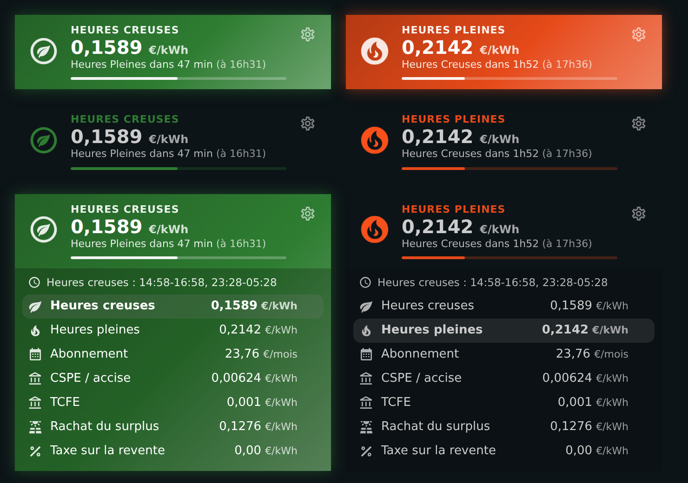
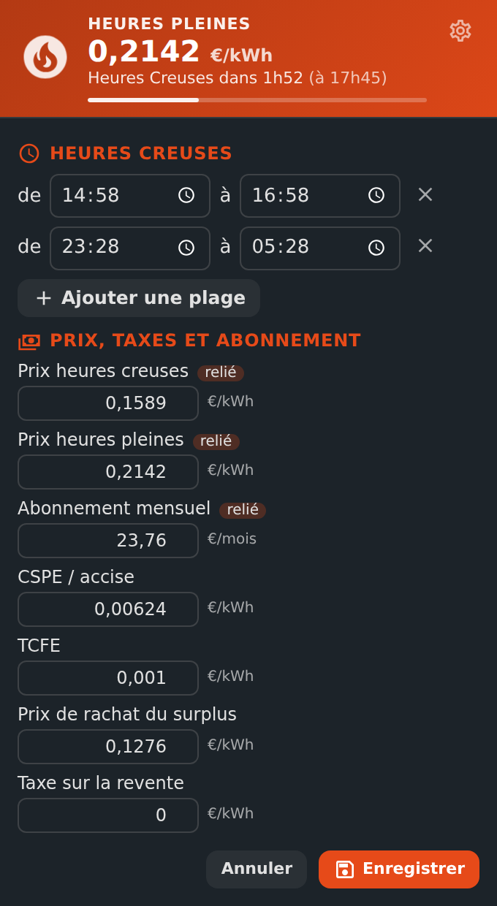

# ⚡ HOLM HP/HC, Tarification et abonnement

[](https://hacs.xyz/)


**Heures creuses ou heures pleines ? Le bon tarif, la prochaine bascule et votre abonnement, au même endroit — sans modèle Jinja ni carte bricolée.**

HOLM HP/HC sait à tout moment si vous êtes en **heures creuses** ou en **heures pleines**, d'après vos plages horaires (ou votre compteur Linky). Il en déduit le **tarif en cours**, annonce la **prochaine bascule** et regroupe vos **prix, taxes et abonnement**. Vos automatisations, le tableau Énergie et les autres cartes HOLM s'appuient sur la même référence.

> 💡 La période ne dépend **pas** du prix : quand votre fournisseur change ses tarifs, il suffit de mettre à jour les prix, rien ne bascule à tort.

### En bref

- 🌗 **Plages heures creuses** en clair : `14:58-16:58, 23:28-05:28` — autant de plages que nécessaire, y compris à cheval sur minuit, changements d'heure compris.
- 📟 **Compteur Linky facultatif** : si votre compteur indique la période en cours, il prime sur les horaires.
- 💶 **Prix, taxes et abonnement portés par l'intégration** : saisis à l'installation, modifiables ensuite dans Home Assistant ou **depuis la carte**. Rien à créer avant.
- 🔗 **Entrées existantes reliées** : vous aviez déjà vos `input_number` (tableau Énergie, cartes) ? Ils sont détectés et restent à jour dans les deux sens.
- ⏱️ **Prochaine bascule** à la minute, et un **évènement** à chaque changement pour vos automatisations.
- 🧾 **Abonnement, CSPE / accise, TCFE, prix et taxe de rachat** regroupés, avec l'abonnement ramené **par jour**.
- 🎨 **Carte HOLM HP/HC** : vert en heures creuses, orange en heures pleines (fond coloré au choix), avec une partie **Réglages** pour les plages et les prix.

| Fond coloré, partiel ou aux couleurs du thème | Les réglages dans la carte |
|---|---|
|  |  |

---

## Installation

### Avec HACS (recommandé)

1. HACS → menu ⋮ → **Dépôts personnalisés** → ajoutez `https://github.com/kaaribou/holm-tarif`, catégorie **Intégration**.
2. Recherchez **HOLM HP/HC** → **Télécharger**, puis redémarrez Home Assistant.

### Manuellement

Copiez `custom_components/holm_tarif` dans le dossier `custom_components` de votre configuration, puis redémarrez Home Assistant.

## Configuration

**Paramètres → Appareils et services → Ajouter une intégration → HOLM HP/HC.**

1. **Plages heures creuses** : `14:58-16:58, 23:28-05:28` (une plage peut passer minuit).
2. **Prix, taxes et abonnement** : prix du kWh HC et HP, abonnement mensuel, CSPE / accise, TCFE, prix et taxe de rachat du surplus. Tout est facultatif sauf ce dont vous avez besoin.
3. **Entrées existantes et compteur** (facultatif) :
   - si vous avez déjà des entrées de prix (`input_number`) utilisées par le tableau Énergie ou vos cartes, **reliez-les** : elles sont détectées automatiquement, et chaque modification de prix les met à jour (et inversement) ;
   - si votre compteur Linky indique la période en cours, choisissez-le : il prime sur les horaires.

Tout se modifie ensuite dans **Configurer**, ou directement depuis la carte (bouton ⚙).

## Entités

| Entité | Valeur |
|---|---|
| `binary_sensor.heures_creuses` | Allumé pendant les heures creuses — la référence pour vos automatisations |
| `sensor.mode_heure` | `Heures Creuses` / `Heures Pleines` |
| `sensor.tarif_actuel` | Prix du kWh en cours (€/kWh), avec tous les prix en attributs |
| `sensor.prochain_changement_de_mode` | « Heures Pleines dans 1h37m » |
| `sensor.prochaine_bascule` | Date et heure de la prochaine bascule |
| `sensor.abonnement_par_jour` | Abonnement mensuel ramené à la journée (€) |
| `number.tarif_prix_hc`, `number.tarif_prix_hp` | Prix du kWh en heures creuses / pleines (modifiables) |
| `number.tarif_abonnement` | Abonnement mensuel |
| `number.tarif_cspe`, `number.tarif_tcfe` | Taxes par kWh |
| `number.tarif_prix_rachat`, `number.tarif_taxe_revente` | Rachat du surplus solaire |

**Évènement** `holm_tarif_changement` à chaque bascule (`periode`, `heures_creuses`, `tarif`, `prochaine_bascule`) :

```yaml
triggers:
  - trigger: state
    entity_id: binary_sensor.heures_creuses
    to: "on"
actions:
  - action: switch.turn_on
    target:
      entity_id: switch.chauffe_eau
```

### Vous aviez déjà vos propres capteurs modèles ?

Si vous utilisiez des capteurs modèles nommés **Mode heure**, **Tarif actuel** ou **Prochain changement de mode**, supprimez-les de votre configuration et redémarrez **avant** d'ajouter l'intégration : elle reprend alors les mêmes noms d'entités, et leur **historique continue**. Vos cartes qui les utilisaient fonctionnent sans changement.

## La carte HOLM HP/HC

Ajoutée automatiquement aux ressources du tableau de bord : ajoutez la carte **HOLM HP/HC**.

```yaml
type: custom:holm-tarif-card
background: always        # always, hc, hp ou never
show_details: true        # tarifs et abonnement
```

| Option | Description | Par défaut |
|---|---|---|
| `entity` | Capteur « Heures creuses » de l'intégration | trouvé automatiquement |
| `name` | Titre | Heures creuses / Heures pleines |
| `show_details` | Afficher les tarifs, taxes et abonnement (modifiables) | `false` |
| `show_progress` | Barre d'avancement de la période en cours | `true` |
| `background` | Fond coloré : `always`, `hc` (heures creuses seulement), `hp` (heures pleines seulement), `never` (fond du thème) | `always` |
| `show_settings` | Bouton ⚙ **Réglages** (administrateurs seulement) | `true` |
| `colors` | `hc` et `hp` | vert / orange |

L'éditeur visuel est disponible. Un toucher sur la carte ouvre le détail de la période.

**Réglages** (bouton ⚙, réservé aux administrateurs de Home Assistant) : ajoutez, modifiez ou supprimez les plages heures creuses avec des sélecteurs d'heure, et modifiez les prix, taxes et abonnement. **Enregistrer** applique tout immédiatement, sans redémarrage. Les prix reliés à une entrée existante sont signalés : l'entrée est mise à jour en même temps. Avec `show_details`, un administrateur peut aussi modifier un prix d'un simple toucher.

## Avec les autres projets HOLM

- **HOLM Lektrico** : choisissez `binary_sensor.heures_creuses` comme source des heures creuses (valeur `on`).
- **HOLM Ecojoko Card** et cartes énergie : elles utilisent vos mêmes entrées de prix et `sensor.tarif_actuel`.

## FAQ

**La période ne change pas à la bonne heure.** Vérifiez le fuseau horaire de Home Assistant (*Paramètres → Système → Général*) et vos plages dans **Configurer**.

**Mon compteur et les horaires ne sont pas d'accord.** Si un compteur Linky est configuré, c'est lui qui décide ; la prochaine bascule affichée reste calculée d'après vos plages.

---

## Un petit merci ?

L'intégration vous plaît ? Vous pouvez m'offrir une bière 🍺

[](https://paypal.me/kaaribou)

---

## Licence

Code : licence **MIT** — © kaaribou. Voir le [CHANGELOG](CHANGELOG.md).

Fait partie de **HOLM — Home Orchestration & Living Management** : la gestion et l'orchestration intelligente de la maison.

Les autres projets : [Volets HOLM](https://github.com/kaaribou/volets-holm) · [Climat HOLM](https://github.com/kaaribou/climat-holm) · [Carburant HOLM](https://github.com/kaaribou/carburant-holm) · [Commandes à la maison HOLM](https://github.com/kaaribou/commandes-holm) · [HOLM LaMetric](https://github.com/kaaribou/lametric-holm) · [HOLM My Menu](https://github.com/kaaribou/holm-mymenu) · [HOLM Lektrico](https://github.com/kaaribou/lektrico-holm) · [HOLM Navbar Card](https://github.com/kaaribou/holm-navbar-card) · [HOLM Climate Card](https://github.com/kaaribou/climate-card-holm) · [HOLM Music Card](https://github.com/kaaribou/holm-music-card) · [HOLM Sentinel Card](https://github.com/kaaribou/holm-sentinel-card) · [HOLM Security Card](https://github.com/kaaribou/holm-security-card) · [HOLM Recordings Card](https://github.com/kaaribou/holm-recordings-card) · [HOLM Covers Card](https://github.com/kaaribou/holm-covers-card) · [HOLM Runtime Card](https://github.com/kaaribou/holm-runtime-card) · [HOLM Power Flow Card](https://github.com/kaaribou/holm-power-flow-card) · [HOLM Energy Cards](https://github.com/kaaribou/holm-energy-cards) · [HOLM Radiator Card](https://github.com/kaaribou/holm-radiator-card) · [HOLM Floor Card](https://github.com/kaaribou/holm-floor-card) · [HOLM Ecojoko Card](https://github.com/kaaribou/holm-ecojoko-card) · [HOLM Smoke Card](https://github.com/kaaribou/holm-smoke-card) · [HOLM BG Card](https://github.com/kaaribou/holm-bg-card).
